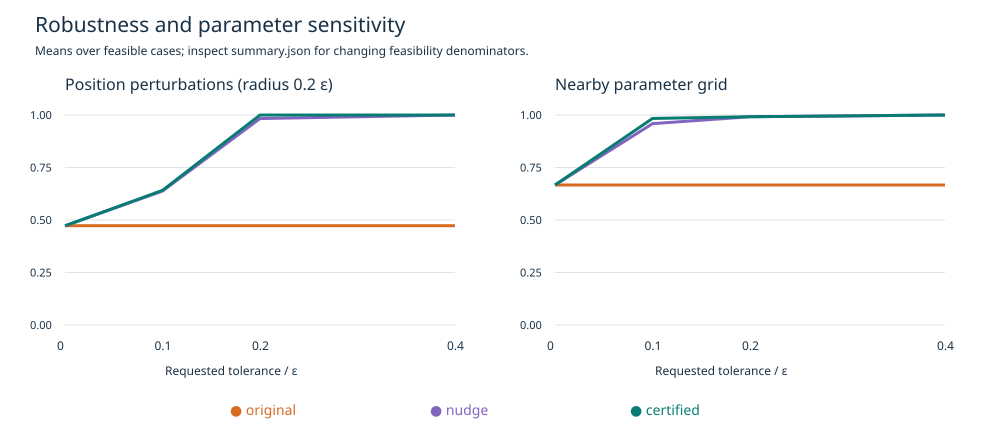

# Robust ExDBSCAN extension

This extension adds (1) a sufficient positional robustness certificate and (2) a parameter-sensitivity check to the existing implementation. The original ExDBSCAN remains unchanged as the baseline. Core computation uses NumPy and project code only; the browser uses native SVG and JavaScript.

## 1. Certified endpoint

For query p, target cluster C and requested tolerance 0 <= rho < epsilon, project p onto each target core's ball of radius epsilon - rho. Keep immutable coordinates equal to p, discard infeasible projections, and select the endpoint z with minimum actual Euclidean movement. Ties use the core's dataset index.

For immutable coordinates I and mutable coordinates J, a core q is feasible when ||p_I-q_I|| <= epsilon-rho. The mutable slice is a ball centered at q_J with radius sqrt((epsilon-rho)^2-||p_I-q_I||^2). Radial projection onto this slice gives its closest endpoint. Checking every target core therefore minimizes movement over this union of shrunken ball slices. The implementation costs O(number of target cores × dimensions) per explanation and does not build a pairwise distance matrix.

The certificate is m = epsilon - ||z-q|| for the selected core. For any error u with ||u|| <= m, the triangle inequality gives:

    ||z + u - q|| <= ||z-q|| + ||u|| <= epsilon.

Thus the perturbed endpoint remains reachable from a target core in the **frozen fitted model**. Floating-point residuals are exposed as `numerical_shortfall`; the UI displays the computed margin. Membership checks in both comparison methods use the same tolerance, 1e-10 × max(1, epsilon).

This is a sufficient single-ball certificate, not the largest possible certificate for the union of overlapping balls. It does not guarantee unique target membership, a particular border assignment, or unchanged clustering after the training data move. Immutable coordinates constrain the recommended action; the certificate also covers unrestricted Euclidean measurement errors. With immutable features, selecting minimum endpoint movement can choose a different core from the original nearest-core method, even when rho = 0.

## 2. Parameter stability

Refit the original data at epsilon × {0.9, 1, 1.1} and MinPts + {-1, 0, 1}, clamping MinPts to 1 and deduplicating. Test the **same endpoint** in every model. Neither query insertion nor endpoint re-optimization occurs during this test.

Cluster numbers have no consistent meaning across fits. Match target identity using original observation indices:

- No original target member in a new non-noise cluster: `disappeared`.
- Original target members in multiple new clusters: `split`.
- The overlapping new cluster contains members of another original non-noise cluster: `merged`.
- Otherwise require member-set Jaccard overlap >= 0.5; lower overlap is `weak_overlap`.
- A resolved match passes only if the endpoint is reachable from its core points.

Unresolved identities count as not passed and retain their reason. The fraction is a descriptive result for this finite grid, not a probability or a parameter-robustness guarantee. The strict split/merge policy intentionally avoids claiming success merely because a large merged cluster contains the endpoint.

## Experiments

Run from the repository root with Python 3.10+ and NumPy:

```bash
python3 exdbscan-study/scripts/run_validation.py
python3 exdbscan-study/scripts/run_experiments.py --dataset mock
python3 exdbscan-study/scripts/run_robust_experiments.py
python3 -m unittest discover -s interactive/tests -v
python3 interactive/server/app.py
```

Open `http://127.0.0.1:8765/robust.html`. This page works without external map assets. Select a query, target, immutable coordinate and tolerance; compare movement, inspect the error circle and parameter grids, then export the request and result as JSON.

The experiment uses blobs, moons and rings with seeds 7 and 19, plus the checked-in USGS snapshot. Four evenly spaced observation indices per snapshot are selected before evaluation; each uses its nearest non-reachable target. Queries with no such target are recorded separately. Both unconstrained and fixed-y actions are attempted. Each endpoint is tested against the same 256 error directions at radius 0.2 epsilon, and the same nine parameter combinations.

Three methods are compared:

1. **Original:** existing ExDBSCAN, k = 1.
2. **Nudge:** move its endpoint a further rho toward its selected core, using mutable coordinates only and stopping at the core's mutable coordinates. This does not generally provide margin rho under fixed-coordinate constraints.
3. **Certified:** search all shrunken target ball slices as above.

Artifacts are in `results/robust/`: `cases.csv` includes every attempted method/tolerance case, `summary.json` includes paired results, skipped queries and source/data hashes, and `comparison.svg` is an exportable vector figure. Timing columns are diagnostic only: the original explanation is precomputed, so these are **not** speed-comparison measurements.

### Observed results

At rho = 0.2 epsilon, all three methods share 27 feasible cases out of 48 attempted scenarios. The other 21 scenarios are retained as infeasible; four query indices had no alternative target and are separately recorded. Repeated methods and tolerances yield 576 CSV rows, not 576 independent scenarios.

| Method | Mean movement / epsilon | Position-error pass rate | Parameter-grid pass rate |
|---|---:|---:|---:|
| Original | 5.0927 | 47.28% | 66.67% |
| Nudge | 5.2927 | 98.31% | 99.18% |
| Certified | 5.3000 | 100.00% | 99.18% |

The certified method requires approximately 4.07% more mean normalized movement than the original on these paired cases. The simple nudge already captures most empirical improvement; the extension's additional value is its explicit certificate, constrained feasibility handling and minimum movement within the chosen sufficient region. At rho = 0.1 epsilon, certified parameter-grid performance is 98.35%, versus 95.88% for nudge. At rho = 0.4 epsilon both achieve 100% on both empirical metrics. These small selected-dataset results do not establish universal superiority; certificates and finite-sample measurements are different claims.

### Validation

65 core tests pass, including 13 extension tests for analytic projection, numerical boundaries, immutable coordinates, infeasibility, deterministic selection, label permutation, splitting/merging, snapshot preservation, and independent distance checks. Nine API tests pass. The browser was checked for successful comparison, fixed-coordinate actions, infeasibility and JSON export; the original endpoint passes the unchanged-parameter cell after applying the shared numerical tolerance.

The existing mock regression experiment also passes: 2,880 queries and 6,318 valid returned points. Its new summary is retained as `results/robust/mock_regression_summary.json`; historical baseline CSVs and their matching gate remain unchanged. Rerun the commands above to refresh the baseline gate before running further real-data baseline experiments. Historical real-data reports outside `results/robust/` remain results of their original runs; the new USGS extension experiment is recorded in the new folder. No speedup claim is made.


