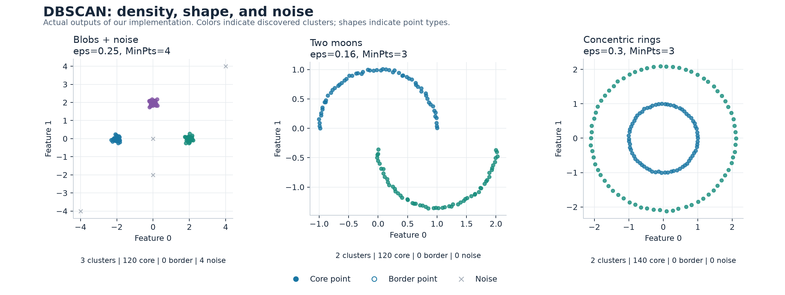
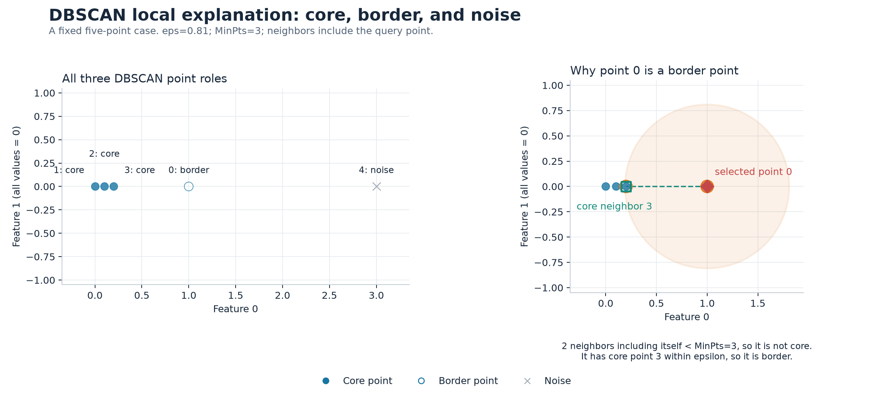
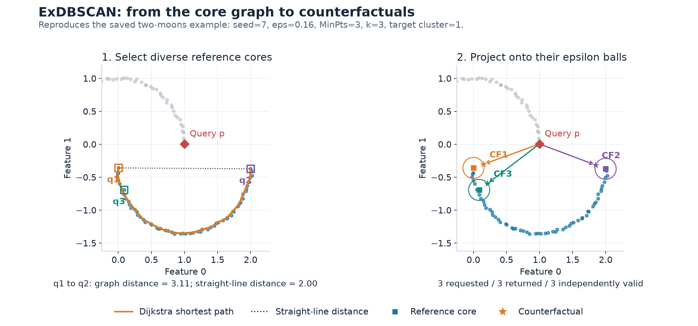
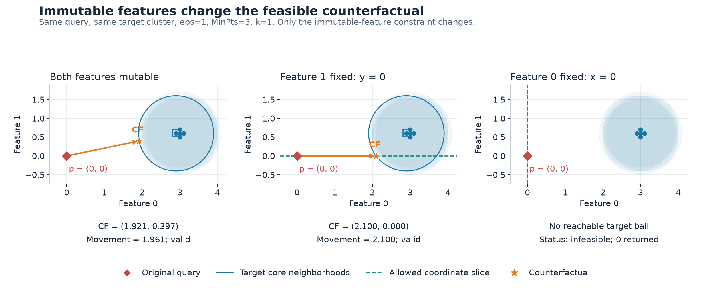
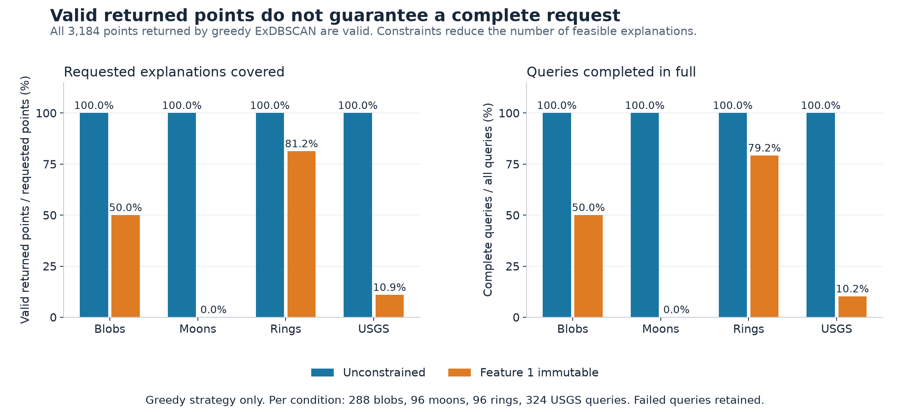
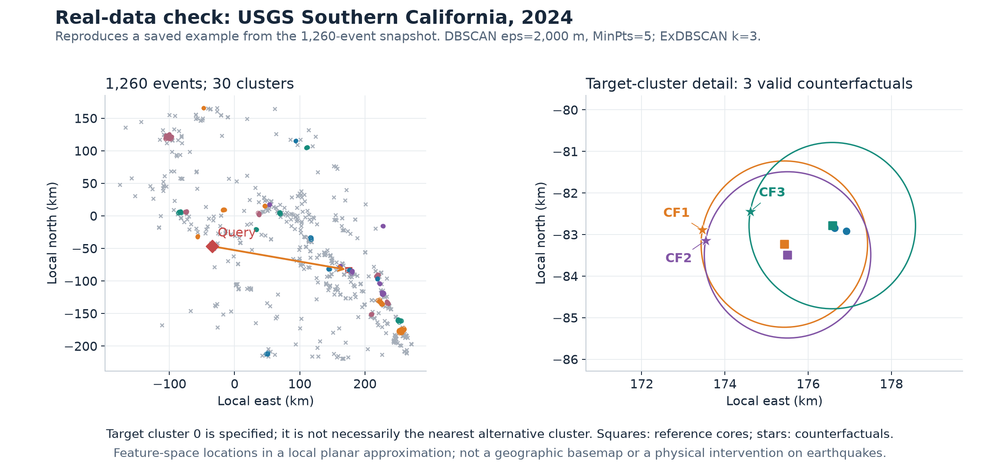

# Visual Results and Demonstrated Functionality

The implementation passes all **52 unit and property tests**. The saved
experiments contain **4,824 queries** across greedy, nearest, and random
selection, yielding **9,552 counterfactuals**, all independently validated.
These figures show actual algorithm outputs and saved experiment statistics.
They do not establish that every possible input is handled correctly or that
the full paper's benchmark results have been reproduced.

## What Has Been Implemented?

| Functionality | Evidence |
|---|---|
| DBSCAN neighborhood counts and core/border/noise classification | 12 DBSCAN tests, Figure 1, and Figure 1A |
| Density-connected cluster expansion and non-spherical clusters | Independent connected-component oracle, two moons, and concentric rings |
| Candidate core graph and Dijkstra shortest paths | 5 graph tests, Floyd-Warshall comparison, and Figure 2 |
| Greedy reference selection and counterfactual projection | 17 ExDBSCAN tests, full-energy comparison, and Figure 2 |
| Immutable-feature feasibility and exact coordinate preservation | 11 constraint tests and Figure 3 |
| Partial and infeasible results without duplicate padding | Edge-case tests and coverage statistics in Figure 4 |
| Independent endpoint verification and separate quality metrics | Every returned experimental point is checked against the fixed core neighborhoods |
| Real spatial-data preparation and reproducible experiments | 6 data tests, recorded hashes, and Figure 5 |
| Independence from third-party clustering and graph algorithms | 1 dependency test blocks sklearn, scipy, and networkx imports while both algorithms run |

DBSCAN, Dijkstra, greedy selection, and geometric projection are implemented in
the project. Matplotlib is an optional rendering dependency only.

## Figure 1: DBSCAN Discovers Clusters and Noise



These representative settings come from the existing mock parameter grid, with
seed 7. The implementation finds three compact clusters and four noise points,
two curved moon-shaped clusters, and two concentric rings. Cluster counts are
discovered from density; they are not supplied as inputs.

Filled circles denote core points, hollow circles denote border points, and
crosses denote noise. These particular settings produce no border points; border
classification, shared borders, and noise-to-border reassignment are covered by
the DBSCAN tests. Results depend on epsilon and MinPts; these panels illustrate
selected configurations, not every setting in the grid.

## Figure 1A: A Local Explanation of Core, Border, and Noise



This fixed five-point case contains three core points, one border point, and one
noise point. With epsilon=0.81 and MinPts=3, selected point 0 has only two
neighbors when the point itself is included, so it is not core. It is nevertheless
within the epsilon-neighborhood of core point 3 and is therefore a border point.
The distant point 4 has no neighboring core point and remains noise.

The example is intentionally small enough to check by hand. The plotting script
asserts the point roles, neighbor counts, selected neighborhood, and neighboring
core point before producing the figure. It complements the larger synthetic
datasets used for parameter experiments.

## Figure 2: Core Graph, Reference Selection, and Counterfactuals



The red diamond is the query p. The left panel shows three reference core points
selected by the implemented greedy objective. The orange path between q1 and q2
is recovered from our Dijkstra distance labels: its length is approximately
3.11, compared with a straight-line distance of approximately 2.00. This shows
why graph distance captures the target cluster's curved structure.

The right panel projects the query toward the epsilon ball of each selected
reference. Stars denote three distinct counterfactuals, all independently
verified to reach the requested target cluster. Arrows represent feature
changes, not constrained travel paths. This example is regenerated from the
parameters in `results/mock_examples.json` and checked against its saved
coordinates and reference indices.

This demonstrates multiple explanations and graph-based diversity selection;
it does not prove global optimality for k > 1 or superiority over every baseline.

## Figure 3: Immutable Features and Infeasibility



The query is (0, 0), the target points lie near (3, 0.6), epsilon=1, MinPts=3,
and k=1 in every panel.

| Constraint | Counterfactual | Euclidean movement | Result |
|---|---|---:|---|
| None | Approximately (1.921, 0.397) | 1.961 | Valid |
| Feature 1 fixed at 0 | (2.100, 0.000) | 2.100 | Valid; fixed coordinate preserved exactly |
| Feature 0 fixed at 0 | None | Not applicable | Infeasible |

Freezing y restricts movement to the horizontal dashed line, increasing the
required change in this example. Freezing x restricts movement to the vertical
line, which never intersects a target core ball. The correct outcome is an
infeasible status with no counterfactual. This is a separate small geometry
demonstration, not an additional row in the benchmark totals.

## Figure 4: Validity, Coverage, and Complete Requests



This figure isolates the **greedy ExDBSCAN strategy**: 1,608 queries and 3,184
returned points. All returned points are valid. The larger totals at the top of
this document also include the nearest and random baseline strategies.

- **Requested coverage** is the number of valid returned points divided by the
  total number requested. A partial result contributes only its valid points.
- **Complete-query rate** is the proportion of queries that return all k
  requested points and pass every validity check.

For the tested unconstrained queries, both measures are 100%. With feature 1
fixed, requested coverage is 50.00% for blobs, 0.00% for moons, 81.25% for rings,
and 10.91% for USGS. Complete-query rates are 50.00%, 0.00%, 79.17%, and 10.19%,
respectively. Rings and USGS include partial results, which explains the
difference between their two measures.

The fixed-y moon queries in this sample cannot reach their requested target
clusters. Their zero coverage describes these sampled queries and settings, not
a claim that all constrained moon datasets are infeasible. They return no
points, so there is no nonempty returned set from which to estimate validity.
Failed and partial queries remain in the statistics.

## Figure 5: Real Spatial Data



The left panel uses all 1,260 locations in the recorded USGS Southern California
2024 snapshot. At epsilon=2,000 meters and MinPts=5, our DBSCAN finds 30 clusters.
The right panel magnifies the specified target cluster and shows three validated
counterfactuals. This reproduces a saved real-data example, including its
reference indices and output coordinates.

The specified target is cluster 0, which need not be the nearest alternative
cluster. The large movement in the overview therefore must not be interpreted
as the minimum change needed to reach any cluster. Axes show local projected
coordinates in kilometers; clustering still uses meters. This is a feature-space
plot, not a geographic basemap or an actionable intervention on earthquakes.

## Reproduce and Reuse the Figures

From the project root, after validation and both experiment stages have passed:

```bash
# Optional plotting dependency; not required by either algorithm
python3 -m pip install matplotlib
python3 examples/plot_results.py
# Figure 1A can be regenerated independently of the saved experiments:
python3 examples/plot_dbscan_explanation.py
```

The original script writes five PNG images and five editable vector SVG files to
`results/figures/`. It also writes `results/visual_examples.json`, which records
the demonstration outputs, independent metrics, shortest-path evidence, plotting
runtime, source fingerprint, script hash, and figure hashes. Saved aggregate
counts are cross-checked against the query CSVs, and the real-data snapshot hash
is checked before plotting.

The separate `plot_dbscan_explanation.py` script produces Figure 1A without
rerunning or changing the saved experiments or their five figures. It records
the five-point input, DBSCAN output, neighborhood checks, rendering runtime,
and figure hashes in `results/dbscan_local_example.json`.

The plot-generation runtime can differ from the algorithm-test runtime; both
are recorded separately. Existing tests, experiment results, and algorithm
source code are not modified by plotting.

For parameter grids and limitations, see [the experiment plan](experiment_plan.md),
[the method specification](method_spec.md), and [the validation report](validation_report.md).
