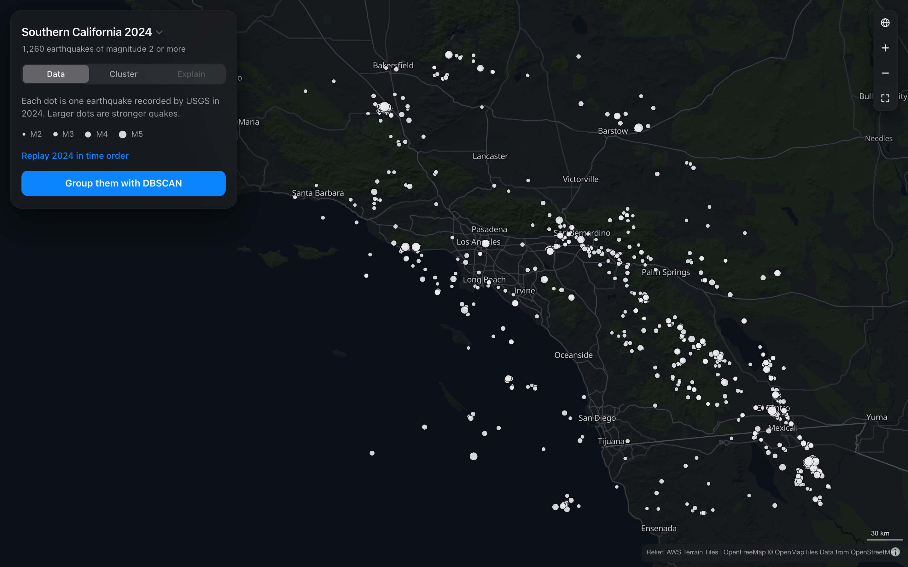
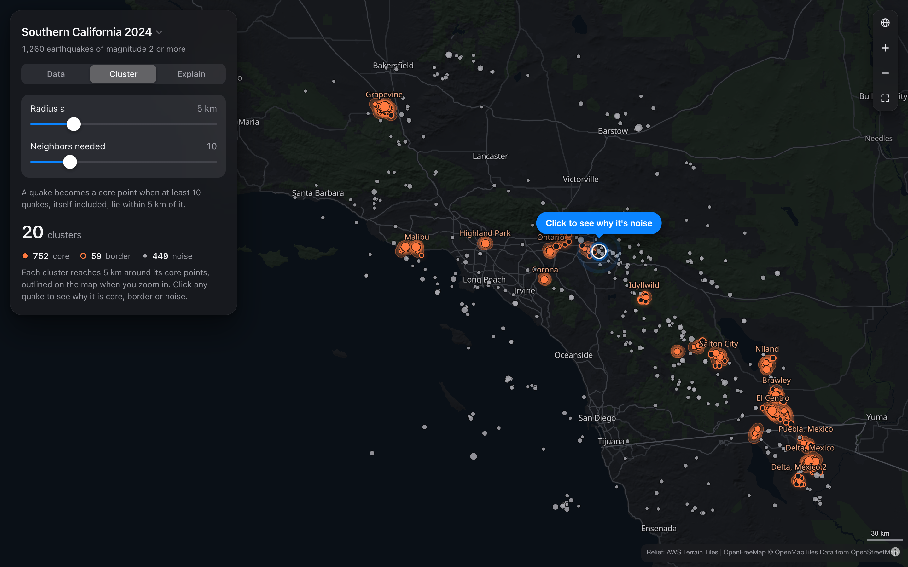
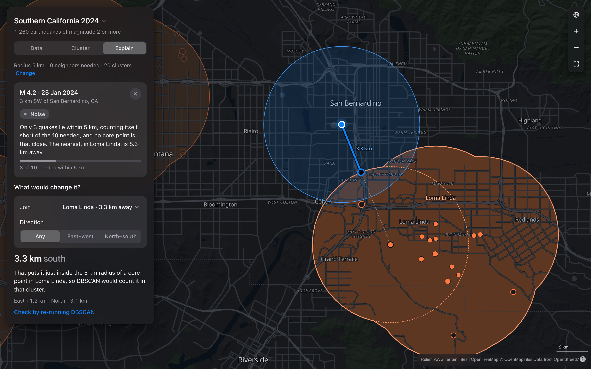
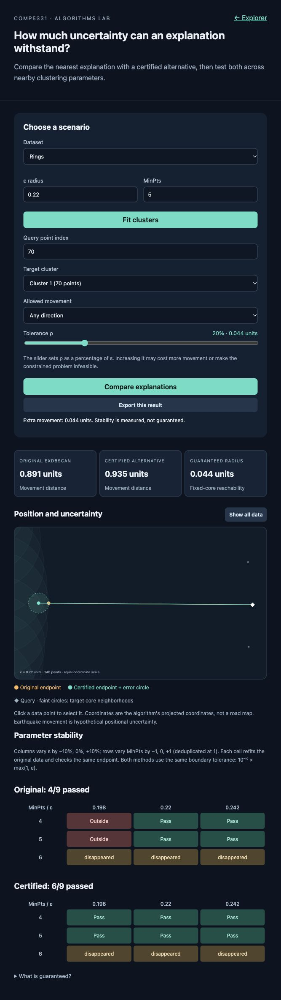

# ExDBSCAN Explorer

An interactive map of the 2024 Southern California earthquakes. It shows how DBSCAN groups them, why each earthquake is a core point, a border point or noise, and the smallest move that would put it in another cluster (ExDBSCAN). Every answer comes from the group's implementation in `exdbscan-study/src`; this folder does not re-implement either algorithm.

## Run it

Requirements: Python 3.10 or later with NumPy (the same as `exdbscan-study`), a current desktop browser, and an internet connection, because the page loads MapLibre GL JS and the map tiles online. There is nothing to compile or install beyond NumPy.

```bash
python3 interactive/server/app.py
```

Then open http://127.0.0.1:8765. Pass `--port 9000` to use another port.

## Screenshots

**Data.** All 1,260 earthquakes, sized by magnitude.



**Cluster.** DBSCAN with the defaults (ε = 5 km, 10 neighbors needed) finds 20 clusters, named after nearby towns. The blue callout points at a quake to click next.



**Explain.** The San Bernardino quake from the example below. It is noise, and moving 3.3 km south would put it inside the Loma Linda cluster.



## Example

1. Click **Explore Southern California**. The globe turns, flies to the region and flattens into a map, and the 1,260 earthquakes appear.
2. Click **Run DBSCAN** with the defaults (radius ε = 5 km, 10 neighbors needed). Clusters grow in the order DBSCAN expands them: orange dots are core points, orange rings are border points, small grey dots are noise.
3. Click the M 4.2 earthquake of 25 Jan 2024, 3 km SW of San Bernardino. The sheet explains that it is noise: only 3 quakes lie within 5 km, counting itself, and the nearest core point, in the Loma Linda cluster, is 8.3 km away.
4. Click **Show the smallest move**. Moving 3.3 km south puts it inside Loma Linda's reach. **Check by re-running DBSCAN** moves it there, reruns DBSCAN, and confirms it joins as a border point.
5. Under **Direction**, choose **East–west**. The answer becomes "Out of reach", and a dashed line shows the only path it may take. Choose **North–south** instead and it can join by moving 3.8 km straight south.

Click any empty spot to test an imagined earthquake. **Adjust** reopens the sliders while a point is selected, so you can watch its role change with ε and MinPts. The dataset menu at the top of the sheet switches to the synthetic Rings, Two moons and Blobs.

## Files

| File | What it does |
|---|---|
| `server/app.py` | Standard-library HTTP server. Serves `web/` and the JSON API: `/api/datasets`, `/api/points`, `/api/cluster`, `/api/why`, `/api/explain`, `/api/verify`. |
| `server/service.py` | Validates requests, caches fitted models, and shapes DBSCAN and ExDBSCAN results for the browser, including the re-clustering check. |
| `server/datasets.py` | Loads the USGS snapshot and the synthetic shapes from `exdbscan-study`, names clusters after nearby towns, and maps data coordinates to longitude and latitude. |
| `web/index.html` | Page shell. |
| `web/css/app.css` | All styling. |
| `web/js/main.js` | App state and the flow between steps. |
| `web/js/map.js` | The MapLibre map: globe intro, basemap colours, and every layer drawn on top. |
| `web/js/panel.js` | The floating sheet: steps, explanations and answers. |
| `web/js/geometry.js` | Coordinate conversion, ε circles and number formatting. |
| `web/js/api.js` | Calls to the JSON API. |

## How it relates to the algorithms

- Coordinates stay in the units DBSCAN uses, metres east and north of 34°N, 118°W. The map draws them through the exact inverse of that projection, so each ε circle on screen is the circle DBSCAN uses.
- ExDBSCAN runs with k = 1, so each answer is a single move. **Direction** passes one immutable feature to ExDBSCAN: East–west keeps north (y) fixed, North–south keeps east (x) fixed.
- A counterfactual lies exactly on an ε boundary. Before rerunning DBSCAN, the check moves the point a further 10⁻⁹ of the way inside, so floating-point rounding cannot leave it just outside.
- Map sources: OpenFreeMap (© OpenMapTiles, © OpenStreetMap contributors) for the basemap, NASA Blue Marble via GIBS for the globe, and AWS Terrain Tiles for relief shading.

Tested on macOS (Darwin 25.6) with Python 3.14, NumPy 2.5 and a Chromium-based browser.

## Use of AI tools

The frontend design was built with the help of Claude.

## API regression tests

From the repository root, run:

```bash
python3 -m unittest discover -s interactive/tests -v
```

The tests start a temporary localhost server on an available port and require
only NumPy and the checked-in data. They cover a successful clustering request,
invalid dataset types, malformed JSON, invalid request lengths, oversized bodies,
unsupported transfer encoding and unknown routes. No browser or map connection
is needed.

POST requests must contain a JSON object and a single non-negative
`Content-Length`. Bodies larger than 64 KiB return HTTP 413 before being read;
invalid framing and invalid input return HTTP 400. Chunked requests are not
supported. The browser client supplies the length automatically.

## Robust comparison lab

Open `/robust.html` on the same local server. Unlike the map explorer, this page
uses only local assets and native SVG. It compares the original endpoint with a
certified endpoint, supports immutable coordinates, shows nearby-parameter
stability grids and exports the request/result as JSON. Its implementation lives
in `web/robust.html`, `web/js/robust.js` and `web/css/robust.css`.

`POST /api/robust` accepts the usual `dataset`, `eps`, `minPts`, `index` (or
`point`) and `fixed` fields, plus integer `target` and `rho` satisfying
`0 <= rho < eps`. An infeasible geometric request returns `status: infeasible`;
invalid input returns HTTP 400. A successful response includes the baseline,
computed certificate and both stability grids.

See [method, guarantees and experiments](../exdbscan-study/docs/robust_extension.md).
The nine API tests also cover this endpoint and offline page assets.


